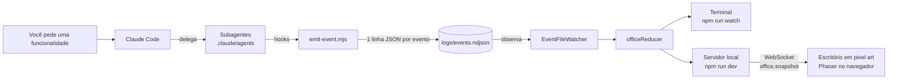

# 🦉 OwllFloor

**An AI dev team you can watch working.**

O OwllFloor é um escritório em pixel art onde cada coruja é um subagente do Claude Code:
**Arquiteto, Engenheiro, Segurança, QA e DevOps**. Quando você pede uma funcionalidade ao
Claude Code, ele delega o trabalho entre as corujas — e você vê cada uma sentar na mesa,
trabalhar, levantar e entregar a tarefa para a próxima.

Nada é encenado: a tela reage a **eventos reais** gerados pelos hooks do Claude Code.
O OwllFloor não chama nenhuma API de IA; ele só observa e mostra.

## Status

🚧 **Etapa 3 concluída — o escritório em pixel art.** As corujas aparecem no navegador
(Phaser), sentam, digitam, levantam e levam o trabalho até a próxima mesa. Quando o QA
devolve a entrega para o Engenheiro, o retrabalho aparece em destaque (em vermelho).

| Etapa | Entrega | Status |
|---|---|---|
| 1 | Subagentes, hooks, contrato de eventos, reducer e escritório no terminal | ✅ |
| 2 | Servidor WebSocket transmitindo os eventos | ✅ |
| 3 | Escritório visual em Phaser com as corujas (Vite + pixel art) | ✅ |
| 4 | Docker, CI e vídeo demo | ⏳ |

## Como funciona



**Fluxo do expediente:** Arquiteto → Engenheiro → Segurança → QA → DevOps.
Se o QA reprovar, a entrega volta para o Engenheiro (retrabalho) e passa de novo por Segurança e QA.

## Rodando

Pré-requisitos: Node 22.12+ e Claude Code.

```bash
git clone https://github.com/FelipeeBrito/OwllFloor.git
cd OwllFloor
npm install
```

**Ver o escritório no navegador com uma simulação** (não usa o Claude):

```bash
# terminal 1 — abre http://127.0.0.1:4747 sozinho
npm run dev

# terminal 2
npm run simulate
```

Variáveis opcionais do `npm run dev`:

| Variável | Para quê | Padrão |
|---|---|---|
| `OF_PORT` | porta do servidor (1–65535) | `4747` |
| `OF_NO_OPEN=1` | não abrir o navegador sozinho | abre |
| `OF_EVENTS_FILE` | arquivo de eventos lido | `logs/events.ndjson` |

O jeito de definir a variável muda conforme o terminal:

```powershell
# Windows (PowerShell) — vale para esta janela do terminal
$env:OF_PORT=4848; npm run dev
$env:OF_NO_OPEN=1; npm run dev
```

```bash
# Git Bash, Mac ou Linux — vale só para este comando
OF_PORT=4848 npm run dev
OF_NO_OPEN=1 npm run dev
```

No PowerShell a variável continua definida até fechar a janela; para desfazer, use
`Remove-Item Env:OF_PORT`.

O servidor escuta só em `127.0.0.1` (não aparece para outras máquinas da rede).
Mudanças na página aparecem sozinhas ao salvar (o Vite recarrega o navegador); mudanças no
servidor pedem reiniciar o `npm run dev`.

**Página compilada (sem o Vite):**

```bash
npm run build   # gera dist/web
npm start       # serve dist/web em http://127.0.0.1:4747
```

### O que você vê no escritório

| Na tela | Evento que causou |
|---|---|
| Coruja pula para a cadeira e digita, com a tarefa num balão | `agent.started` |
| Coruja levanta, volta para a frente da mesa e ganha um ✔ verde | `agent.finished` |
| Coruja leva um papel pelo corredor até a próxima | entrega (`handoff`) entre duas corujas |
| Faixa vermelha, papel vermelho, tela tremendo, balão vermelho | retrabalho: QA devolveu ao Engenheiro |
| "z z" sobre a coruja | coruja livre |
| Luzes apagadas e placa "FECHADO" | `session.ended` |

Cada coruja tem o acessório do seu papel: **Arquiteto** (óculos e planta), **Engenheiro**
(teclado), **Segurança** (escudo), **QA** (lupa) e **DevOps** (capacete).

**Ver o escritório no terminal com uma simulação:**

```bash
# terminal 1
npm run watch

# terminal 2
npm run simulate
```

**Ver o escritório com o Claude de verdade:**

```bash
# terminal 1 (ou npm run watch, para o modo texto)
npm run dev

# terminal 2, dentro da pasta do projeto
claude
```

Depois peça uma funcionalidade ao Claude Code, por exemplo: *"use o fluxo do escritório para
criar uma função que formata datas em pt-BR"*. As corujas começam a trabalhar na página (ou no terminal 1).

## Decisões técnicas

- **Eventos em arquivo NDJSON**, não em banco ou fila: é o jeito mais simples de os hooks
  (processos curtos) conversarem com o escritório (processo longo). Pode virar WebSocket ou
  mensageria depois, sem mudar o domínio.
- **Reducer puro** (`estado + evento → novo estado`): cada regra é testável isoladamente e um
  expediente inteiro pode ser reproduzido relendo o arquivo.
- **Observer** no leitor de eventos: o terminal hoje e a tela em Phaser amanhã se inscrevem
  na mesma fonte.
- **Servidor local com WebSocket** ([ADR 0001](docs/adr/0001-servidor-websocket.md)): um único
  processo lê os eventos, serve a página e transmite sempre a *foto completa* do estado
  (`office.snapshot`). Se a conexão cair, a página reconecta sozinha e já recebe a tela certa.
  Segurança básica: só `127.0.0.1`, checagem de `Host` e `Origin`, CSP restritiva e texto dos
  eventos exibido só com `textContent`.
- **Vite + Phaser** ([ADR 0002](docs/adr/0002-vite-e-phaser.md)): o Vite roda *dentro* do
  servidor do OF (mesma porta, mesmas checagens de segurança). A pixel art é desenhada em
  código (cada letra é um pixel), sem imagens de terceiros. Uma *coreografia* pura compara a
  foto anterior com a nova e decide as animações; o Phaser só as executa.
- **Hook sem dependências e que nunca falha**: o escritório é visual; ele jamais pode
  atrapalhar o trabalho do Claude Code.

Melhorias já conhecidas e ainda não feitas estão em
[Pendentes conhecidos](docs/adr/0001-servidor-websocket.md#pendentes-conhecidos).

## Estrutura

```
.claude/
  agents/          # as 5 corujas (subagentes)
  hooks/           # emit-event.mjs: hook → evento
  settings.json    # quais momentos do Claude Code disparam o hook
src/
  domain/          # regras puras: papéis, eventos, reducer
  infra/           # leitura do arquivo de eventos
  cli/             # escritório em modo texto
  server/          # servidor local: HTTP + WebSocket + Vite (npm run dev)
web/
  index.html       # página (o Vite começa por aqui)
  public/          # style.css e favicon, servidos como estão
  src/             # TypeScript da página: conexão e painel em HTML
    office/        # escritório em Phaser: pixel art, planta, coreografia, corujas
vite.config.ts     # configuração da página (pastas liberadas, build)
vitest.config.ts   # configuração dos testes
docs/adr/          # decisões de arquitetura
scripts/simulate.ts
tests/             # Vitest
```

## Testes

```bash
npm test          # 230 testes
npm run typecheck
```

## Débito técnico conhecido

Coisas que sabemos que podem melhorar, mas que hoje têm gravidade **baixa**. Cada item diz
por que é baixo, quando passaria a valer a pena corrigir e quanto custa corrigir.
Detalhes em `docs/adr/0001-servidor-websocket.md` e `docs/adr/0002-vite-e-phaser.md`.

- **B1 — outros sites podem incluir o JavaScript da página** (gravidade: baixa).
  Falta o cabeçalho `Cross-Origin-Resource-Policy: same-origin` e recusar pedidos com
  `Sec-Fetch-Site: cross-site`.
  *Por que é baixa:* o JavaScript é o código público da página, sem nenhum dado. Os dados vêm
  pelo WebSocket, que já confere de qual site veio a conexão (`Origin`).
  *Corrigir quando:* o JavaScript passar a conter dados sensíveis.
  *Custo:* um cabeçalho e um `if`.
- **B2 — abrir o navegador no Windows sem validar a URL** (gravidade: baixa).
  `openBrowser` não confere a URL antes de chamar o `spawn`.
  *Por que é baixa:* a URL é montada só com o endereço fixo `127.0.0.1` e uma porta numérica;
  nada vem de fora.
  *Corrigir quando:* a URL passar a vir de configuração.
  *Custo:* uma checagem com `^http://127\.0\.0\.1:\d+/$`.
- **B3 — atalhos (symlinks) em `web/public` são seguidos** (gravidade: baixa).
  *Por que é baixa:* para explorar isso alguém precisa criar um atalho dentro do repositório,
  o que exige a mesma confiança de editar o próprio código; e o servidor só atende a máquina
  local.
  *Corrigir quando:* aceitarmos contribuições externas em `web/public`.
  *Custo:* usar `realpath` e conferir que o destino continua dentro da pasta.
- **Watcher não percebe arquivo recriado do mesmo tamanho ou maior** (gravidade: baixa).
  O leitor só detecta que `events.ndjson` foi recriado quando ele fica menor. Se um arquivo
  novo chegar ao mesmo tamanho ou maior entre duas leituras (ex.: `simulate --fast` repetido),
  eventos podem ser perdidos ou lidos do meio.
  *Por que é baixa:* não acontece no uso normal, em que o arquivo só cresce.
  *Corrigir quando:* isso começar a aparecer na prática.
  *Custo:* comparar também a identidade do arquivo (ex.: data de criação), não só o tamanho.
- **Pacote da página grande (~1,4 MB)** (gravidade: baixa).
  Quase tudo é o Phaser.
  *Por que é baixa:* a página roda na própria máquina; carrega uma vez e em menos de um segundo.
  *Corrigir quando:* a página for publicada na internet.
  *Custo:* separar o Phaser num arquivo próprio para o navegador guardar em cache.

## Licença

MIT
