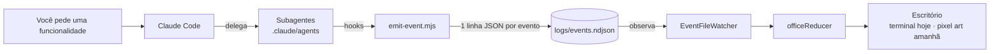

# 🦉 OwllFloor

**An AI dev team you can watch working.**

O OwllFloor é um escritório em pixel art onde cada coruja é um subagente do Claude Code:
**Arquiteto, Engenheiro, Segurança, QA e DevOps**. Quando você pede uma funcionalidade ao
Claude Code, ele delega o trabalho entre as corujas — e você vê cada uma sentar na mesa,
trabalhar, levantar e entregar a tarefa para a próxima.

Nada é encenado: a tela reage a **eventos reais** gerados pelos hooks do Claude Code.
O OwllFloor não chama nenhuma API de IA; ele só observa e mostra.

## Status

🚧 **Etapa 1 concluída — o cérebro do escritório.** O pipeline de eventos funciona e o
escritório já aparece em modo texto. A versão em pixel art (Phaser) é a próxima etapa.

| Etapa | Entrega | Status |
|---|---|---|
| 1 | Subagentes, hooks, contrato de eventos, reducer e escritório no terminal | ✅ |
| 2 | Servidor WebSocket transmitindo os eventos | ⏳ |
| 3 | Escritório visual em Phaser com as corujas | ⏳ |
| 4 | Docker, CI e vídeo demo | ⏳ |

## Como funciona



**Fluxo do expediente:** Arquiteto → Engenheiro → Segurança → QA → DevOps.
Se o QA reprovar, a entrega volta para o Engenheiro (retrabalho) e passa de novo por Segurança e QA.

## Rodando

Pré-requisitos: Node 20+ e Claude Code.

```bash
git clone https://github.com/FelipeeBrito/OwllFloor.git
cd OwllFloor
npm install
```

**Ver o escritório com uma simulação** (não usa o Claude):

```bash
# terminal 1
npm run watch

# terminal 2
npm run simulate
```

**Ver o escritório com o Claude de verdade:**

```bash
# terminal 1
npm run watch

# terminal 2, dentro da pasta do projeto
claude
```

Depois peça uma funcionalidade ao Claude Code, por exemplo: *"use o fluxo do escritório para
criar uma função que formata datas em pt-BR"*. As corujas começam a trabalhar no terminal 1.

## Decisões técnicas

- **Eventos em arquivo NDJSON**, não em banco ou fila: é o jeito mais simples de os hooks
  (processos curtos) conversarem com o escritório (processo longo). Pode virar WebSocket ou
  mensageria depois, sem mudar o domínio.
- **Reducer puro** (`estado + evento → novo estado`): cada regra é testável isoladamente e um
  expediente inteiro pode ser reproduzido relendo o arquivo.
- **Observer** no leitor de eventos: o terminal hoje e a tela em Phaser amanhã se inscrevem
  na mesma fonte.
- **Hook sem dependências e que nunca falha**: o escritório é visual; ele jamais pode
  atrapalhar o trabalho do Claude Code.

## Estrutura

```
.claude/
  agents/          # as 5 corujas (subagentes)
  hooks/           # emit-event.mjs: hook → evento
  settings.json    # quais momentos do Claude Code disparam o hook
src/
  domain/          # regras puras: papéis, eventos, reducer
  infra/           # leitura do arquivo de eventos
  cli/             # escritório em modo texto
scripts/simulate.ts
tests/             # Vitest
```

## Testes

```bash
npm test          # 35 testes
npm run typecheck
```

## Licença

MIT
